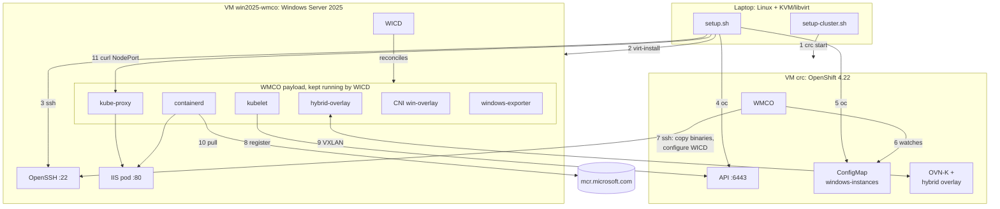

# WMCO lab: Windows Server 2025 node on OpenShift, on one laptop

Two scripts build a complete hybrid Linux/Windows OpenShift lab on a single Linux laptop:

- **`setup-cluster.sh`**: a local OpenShift 4.22 cluster (OpenShift Local / crc) with OVN-Kubernetes hybrid overlay networking.
- **`setup.sh`**: an unattended Windows Server 2025 VM that is patched, joined to the cluster by the Windows Machine Config Operator (WMCO) in Bring-Your-Own-Host mode, and verified with an IIS pod that must answer over HTTP.

```
./setup-cluster.sh   # ~15-30 min, needs a Red Hat pull secret (pull-secret.txt)
./setup.sh           # ~1-2 h on first run (Windows install + updates + 2.4GB image)
```

For an **alternative approach** using OpenShift Virtualization to run Windows VMs as pods, see the [VM-as-Pod section](#alternative-windows-vms-as-pods-openshift-virtualization) below.

## Architecture



The numbers match the table below.

Both VMs run on the laptop and share the `crc` libvirt network (192.168.130.0/24; Windows is 192.168.130.50), so the cluster and the Windows node reach each other directly and reach the internet through the laptop. The laptop drives everything:
- **libvirt** (`virsh`, `virt-install`) for the VMs.
- **`oc`** for the cluster.
- **SSH** for Windows.

Windows itself only needs OpenSSH: WMCO does the rest over SSH. For how WMCO works internally (payload, WICD, the MachineSet path for cloud clusters, which this lab does not use), see Red Hat's [WMCO design diagram](https://docs.redhat.com/en/documentation/openshift_container_platform/4.22/html/windows_container_support_for_openshift/understanding-windows-container-workloads). This lab uses its BYOH path.

### How the parts talk to each other

| # | Arrow | What happens |
|---|---|---|
| 1 | `setup-cluster.sh` → crc VM | `crc setup` / `crc start` create and boot the OpenShift VM on the `crc` libvirt network. The script then logs in as `kubeadmin` and patches the network operator to enable the hybrid overlay. |
| 2 | `setup.sh` → Windows VM, virt-install | Creates the VM with two virtual CD drives: the Windows ISO and a second, tiny ISO that `setup.sh` builds (a few KB) with `autounattend.xml` and the first-logon script `wmco-setup.ps1`. Windows Setup finds `autounattend.xml` on any attached drive automatically, so the install runs without questions. Both CDs are ejected once SSH works. |
| 3 | `setup.sh` → OpenSSH :22 | Once the first-logon script has installed OpenSSH with the generated key, everything `setup.sh` does on Windows goes over SSH as `Administrator`: waiting for the Containers feature, running Windows Update as a scheduled task, the `health` checks and the automatic containerd reset (small PowerShell scripts copied with `scp` and run there). |
| 4 | `setup.sh` → API :6443 | Installs WMCO through OLM (OperatorGroup, Subscription, CSV), stores the SSH private key as the `cloud-private-key` Secret, and later creates the IIS RuntimeClass, Deployment and NodePort Service. |
| 5 | `setup.sh` → ConfigMap | Writes the Windows IP into `windows-instances` (`192.168.130.50: username=Administrator`). This is what turns the VM into a BYOH node. |
| 6 | WMCO → ConfigMap, watches | WMCO watches `windows-instances` and reacts to new or removed entries; removing the entry (`setup.sh cleanup`) makes WMCO deconfigure the node. |
| 7 | WMCO → OpenSSH :22 | WMCO logs in with the same key, copies its payload (kubelet, containerd, kube-proxy, hybrid-overlay, CNI, windows-exporter) and configures **WICD**, the Windows Instance Config Daemon. WICD then starts these services and keeps them running, for example after every reboot. No agent is needed on Windows beforehand. |
| 8 | kubelet → API :6443 | The Windows kubelet connects to `api-int.crc.testing:6443` and registers the node `win2025-wmco`; it then appears in `oc get nodes`. |
| 9 | hybrid-overlay ↔ OVN-K | Pod traffic between the Linux cluster network and Windows pods (10.132.0.0/14) travels in a VXLAN tunnel on UDP 4789 between the two VMs. The CNI plugin `win-overlay` attaches each Windows pod to this network. |
| 10 | containerd → mcr.microsoft.com | containerd on Windows downloads the pause and IIS images from Microsoft's registry, through the laptop's NAT. |
| 11 | `setup.sh` → kube-proxy NodePort → IIS | Phase 8's final check: `curl http://192.168.130.50:<NodePort>/` from the laptop. kube-proxy on Windows forwards the NodePort to the IIS pod's port 80; phase 8 passes only on HTTP 200. |

## What `setup.sh` does

| # | Phase | Runs on | What happens |
|---|---|---|---|
| 1 | Prerequisites | laptop | packages, libvirt access, `oc` login (auto-login to crc), hybrid overlay check, SSH key |
| 2 | Windows ISO | laptop | download the Windows Server 2025 evaluation ISO once (~6GB) |
| 3 | Create VM | laptop | 4 vCPU / 8GB / 60GB, SATA + e1000e, fixed MAC with DHCP reservation, autounattend ISO |
| 4 | Windows install | Windows | unattended install; the laptop waits for an IP |
| 5 | First logon script | Windows | OpenSSH server (uses your generated key), Containers feature, `C:\wmco-setup.done` |
| 6 | Windows Update | Windows | Update session as a scheduled task (~20-40 min); the laptop polls until the .done marker |
| 7 | WMCO operator & setup | cluster | Subscription, cloud-private-key Secret, `windows-instances` ConfigMap |
| 8 | Verify Windows node + IIS pod | cluster + Windows | waits for the node, creates RuntimeClass / Deployment / Service, curls the IIS NodePort, done |

After every reboot (or if `oc get nodes` loses the Windows node), re-run **phase 8** to bring the services back and check connectivity:

```bash
./setup.sh 8
```

## Usage

| Command | What it does |
|---|---|
| `./setup-cluster.sh` | set up / start the crc VM (OpenShift) |
| `./setup-cluster.sh cleanup` | delete the VM |
| `./setup-cluster.sh status` | VM status and cluster operators |
| `./setup.sh` | full run: cluster, Windows VM, WMCO, IIS |
| `./setup.sh 7` | pick up at phase 7 (WMCO operator & setup) |
| `./setup.sh 8` | pick up at phase 8 (verify) |
| `./setup.sh health` | manual checks: node status, WMCO logs, `curl` IIS, Windows node info |
| `./setup.sh observe-pod` | stream `oc get pod -w` for the IIS pod |
| `./setup.sh diagnose-windows` | container runtime diagnostics on the Windows node |
| `./setup.sh reset-containerd` | download fresh images and reset containerd |
| `./setup.sh cleanup` | stop/delete Windows VM; remove cluster operator; keep crc running |
| `./setup.sh cleanup-all` | cleanup + stop crc (keep crc files) |
| `./setup.sh cleanup-delete-crc` | cleanup-all + delete crc's storage |
| `./setup.sh vnc` | open the Windows VM console (virt-viewer) |

---

# Alternative: Windows VMs as Pods (OpenShift Virtualization)

This section covers an **alternative approach** to running Windows VMs using **OpenShift Virtualization (KubeVirt)** where VMs run as pods inside the cluster, rather than as separate libvirt VMs.

## Overview

This approach provides scripts to:
- Set up OpenShift Local (CRC) cluster with OpenShift Virtualization
- Create Windows VMs running as pods using KubeVirt
- Fully automated Windows installation with network verification
- Serial console support via Emergency Management Services (EMS)
- Comprehensive CI testing

## Quick Start

### 1. Set up OpenShift Cluster

```bash
# Create CRC cluster with resources for virtualization
./setup-cluster.sh

# Check cluster status
./setup-cluster.sh status
```

### 2. Create Windows VM as a Pod

```bash
# Create Windows VM running as a pod
./spawn-vm-pod.sh windows

# Check VM network status
./check-vm-network.sh

# Monitor installation progress (15-20 min)
virtctl vnc windows-pod-vm -n virt-windows
```

## Scripts

### spawn-vm-pod.sh
Creates Windows VMs running as pods using OpenShift Virtualization (KubeVirt).

**Usage:**
```bash
./spawn-vm-pod.sh                # Create Fedora VM (proof of concept)
./spawn-vm-pod.sh windows        # Create Windows VM
./spawn-vm-pod.sh wait-install   # Monitor Windows installation progress
./spawn-vm-pod.sh verify-windows # Verify Windows workload completion
./spawn-vm-pod.sh run-workload   # Show workload test instructions
./spawn-vm-pod.sh cleanup        # Delete VMs and PVCs
./spawn-vm-pod.sh cleanup --all  # Delete VMs, PVCs, and namespace
```

**Features:**
- Installs OpenShift Virtualization operator automatically
- Uploads Windows ISO to cluster storage
- Fully unattended Windows installation
- Emergency Management Services (EMS) enabled for serial console
- Network connectivity with e1000e adapter
- Automatic network verification (IP assignment, internet connectivity)
- Reuses configuration from setup.sh for consistency

**Documentation:**
- [Windows VM Guide](.wmco-work/WINDOWS-VM-GUIDE.md) - Production deployment guide
- [VM Operations Guide](.wmco-work/VM-OPERATIONS-GUIDE.md) - VM lifecycle and operations

### check-vm-network.sh
Check Windows VM network status when running as a pod.

**Usage:**
```bash
./check-vm-network.sh           # Show VM network status
./check-vm-network.sh console   # Connect to Windows console
```

### run-ci.sh
Continuous Integration test suite for all WMCO setup scripts.

**Usage:**
```bash
./run-ci.sh              # Run full test suite
./run-ci.sh quick        # Quick tests (skip long-running installs)
./run-ci.sh cluster      # Test cluster setup only
./run-ci.sh vm-pod       # Test VM-as-pod only
```

**Tests:**
- CRC cluster setup and accessibility
- virtctl installation
- OpenShift Virtualization operator
- Fedora VM as pod creation
- Windows VM as pod creation
- Network connectivity verification
- Workload completion checks
- Documentation completeness

## Requirements

### Host System
- **RAM:** 42GB+ (32GB for CRC, 8GB for Windows VM, 2GB for host)
- **CPU:** 8+ cores
- **Disk:** 150GB+ free space
- **OS:** Fedora/RHEL/Ubuntu Linux with KVM support
- **Nested virtualization:** Required (check with `grep -E 'vmx|svm' /proc/cpuinfo`)

### Software
- libvirt, qemu-kvm, virt-install
- OpenShift Local (crc) - downloaded automatically
- virtctl - installed automatically for VM-as-pod functionality
- Red Hat pull secret (free): https://console.redhat.com/openshift/create/local

### Windows ISO
- Download Windows Server 2025 Evaluation ISO
- Place at: `/var/lib/libvirt/images/windows-server-2025-eval.iso`
- Or set: `WIN_ISO=/path/to/your/windows.iso`

## Architecture

### VM-as-Pod Setup (spawn-vm-pod.sh)
```
┌─────────────────────────────────────────────┐
│ Host Machine                                │
│ ┌─────────────────────────────────────────┐ │
│ │ CRC VM (OpenShift)                      │ │
│ │ ┌─────────────────────────────────────┐ │ │
│ │ │ OpenShift Virtualization (KubeVirt) │ │ │
│ │ │                                     │ │ │
│ │ │ ┌─────────────────────────────────┐ │ │ │
│ │ │ │ Windows Pod                     │ │ │ │
│ │ │ │ - virt-launcher container       │ │ │ │
│ │ │ │ - QEMU process                  │ │ │ │
│ │ │ │ - Windows Server VM             │ │ │ │
│ │ │ └─────────────────────────────────┘ │ │ │
│ │ └─────────────────────────────────────┘ │ │
│ └─────────────────────────────────────────┘ │
└─────────────────────────────────────────────┘
```

## Key Learnings

### Windows VM as Pod Configuration
- **Storage:** Must use SATA bus (SCSI doesn't work - autounattend.xml not found)
- **Network:** Use e1000e adapter (Windows has native drivers, virtio-net requires extra drivers)
- **ISO Format:** Must have Joliet extensions for long filenames (autounattend.xml)
- **Boot Order:** Disk first, then ISOs (after installation completes)
- **Serial Console:** Emergency Management Services (EMS) enabled automatically for serial console access

## Troubleshooting

### Windows VM Pod Issues
```bash
./check-vm-network.sh               # Check network status
oc get vm,vmi -n virt-windows       # Check VM status
oc get events -n virt-windows       # View events
oc logs -n virt-windows <pod> -c compute  # View QEMU logs
```

**Serial console is blank:**
- This is normal during Windows installation
- Serial console only works after Windows boots into installed OS
- Use VNC instead: `virtctl vnc windows-pod-vm -n virt-windows`
- After installation completes, serial console will work (EMS enabled automatically)

### Common Issues

**Out of memory:**
- Increase CRC resources: `CRC_MEMORY_MB=32768 ./setup-cluster.sh`

**Nested virtualization not enabled:**
```bash
# Check if enabled
grep -E 'vmx|svm' /proc/cpuinfo

# Enable (requires reboot)
# Intel: Add intel_iommu=on to kernel params
# AMD: Add amd_iommu=on to kernel params
```

**Windows installation stuck:**
- Check VNC console: `virtctl vnc windows-pod-vm -n virt-windows`
- For VM pods: Ensure SATA bus is used (not SCSI)
- Verify autounattend.xml in config ISO

## Project Structure

```
.
├── setup-cluster.sh           # CRC cluster management
├── setup.sh                   # Windows VM + WMCO setup (libvirt)
├── spawn-vm-pod.sh           # Windows VM as pod (KubeVirt)
├── check-vm-network.sh       # VM network status checker
├── run-ci.sh                 # CI test suite for all scripts
├── .wmco-work/               # Working directory
│   ├── WINDOWS-VM-GUIDE.md   # Windows VM as pod production guide
│   ├── VM-OPERATIONS-GUIDE.md # VM lifecycle operations
│   ├── vm-pod-autounattend.iso # Config ISO for unattended install
│   ├── ci-test.log           # CI test results
│   └── iso/                  # ISO build directory
├── pull-secret.txt           # Your Red Hat pull secret (gitignored)
└── README.md                 # This file
```

## Environment Variables

### CRC Configuration
- `CRC_MEMORY_MB` - CRC memory (default: 32768)
- `CRC_CPUS` - CRC CPUs (default: 8)
- `CRC_DISK_GB` - CRC disk size (default: 150)

### Windows VM Configuration
- `VM_NAME` - VM name (default: windows-node)
- `VM_RAM_MB` - VM memory (default: 8192)
- `VM_CPUS` - VM CPUs (default: 4)
- `VM_DISK_GB` - VM disk size (default: 100)
- `WIN_ISO` - Windows ISO path (default: /var/lib/libvirt/images/windows-server-2025-eval.iso)
- `WIN_PASSWORD` - Administrator password (default: Windows123!)

## Contributing

When making changes:
1. Test on a fresh CRC cluster: `./setup-cluster.sh cleanup && ./setup-cluster.sh`
2. Run the CI test suite: `./run-ci.sh quick` (or `./run-ci.sh` for full tests)
3. Verify Windows installation completes unattended
4. Check WMCO functionality with `./setup.sh health`
5. Test VM-as-pod with `./spawn-vm-pod.sh windows`
6. Verify network and workload: `./spawn-vm-pod.sh verify-windows`
7. Document any new learnings or workarounds

## References

- [WMCO Documentation](https://github.com/openshift/windows-machine-config-operator)
- [OpenShift Local (CRC)](https://developers.redhat.com/products/openshift-local/overview)
- [OpenShift Virtualization](https://docs.openshift.com/container-platform/latest/virt/about_virt/about-virt.html)
- [KubeVirt](https://kubevirt.io/)
