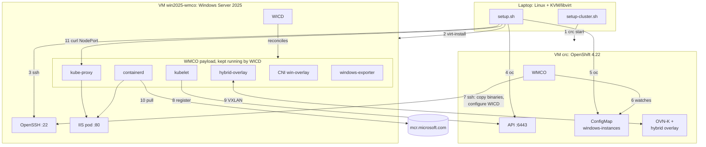

# WMCO lab: Windows Server 2025 node on OpenShift, on one laptop

Two scripts build a complete hybrid Linux/Windows OpenShift lab on a single Linux laptop:

- **`setup-cluster.sh`**: a local OpenShift 4.22 cluster (OpenShift Local / crc) with OVN-Kubernetes hybrid overlay networking.
- **`setup.sh`**: an unattended Windows Server 2025 VM that is patched, joined to the cluster by the Windows Machine Config Operator (WMCO) in Bring-Your-Own-Host mode, and verified with an IIS pod that must answer over HTTP.

```
./setup-cluster.sh   # ~15-30 min, needs a Red Hat pull secret (pull-secret.txt)
./setup.sh           # ~1-2 h on first run (Windows install + updates + 2.4GB image)
```

## Architecture



The numbers match the table below.

Both VMs run on the laptop and share the `crc` libvirt network (192.168.130.0/24; Windows is 192.168.130.50), so the cluster and the Windows node reach each other directly and reach the internet through the laptop. The laptop drives everything:
- **libvirt** (`virsh`, `virt-install`) for the VMs.
- **`oc`** for the cluster.
- **SSH** for Windows.

Windows itself only needs OpenSSH: WMCO does the rest over SSH. For how WMCO works internally (payload, WICD, the MachineSet path for cloud clusters, which this lab does not use), see Red Hat's [WMCO design diagram](https://docs.redhat.com/en/documentation/openshift_container_platform/4.22/html/windows_container_support_for_openshift/understanding-windows-container-workloads). This lab uses its BYOH path.

### How the parts talk to each other

| # | Arrow | What happens |
|---|---|---|
| 1 | `setup-cluster.sh` → crc VM | `crc setup` / `crc start` create and boot the OpenShift VM on the `crc` libvirt network. The script then logs in as `kubeadmin` and patches the network operator to enable the hybrid overlay. |
| 2 | `setup.sh` → Windows VM, virt-install | Creates the VM with two virtual CD drives: the Windows ISO and a second, tiny ISO that `setup.sh` builds (a few KB) with `autounattend.xml` and the first-logon script `wmco-setup.ps1`. Windows Setup finds `autounattend.xml` on any attached drive automatically, so the install runs without questions. Both CDs are ejected once SSH works. |
| 3 | `setup.sh` → OpenSSH :22 | Once the first-logon script has installed OpenSSH with the generated key, everything `setup.sh` does on Windows goes over SSH as `Administrator`: waiting for the Containers feature, running Windows Update as a scheduled task, the `health` checks and the automatic containerd reset (small PowerShell scripts copied with `scp` and run there). |
| 4 | `setup.sh` → API :6443 | Installs WMCO through OLM (OperatorGroup, Subscription, CSV), stores the SSH private key as the `cloud-private-key` Secret, and later creates the IIS RuntimeClass, Deployment and NodePort Service. |
| 5 | `setup.sh` → ConfigMap | Writes the Windows IP into `windows-instances` (`192.168.130.50: username=Administrator`). This is what turns the VM into a BYOH node. |
| 6 | WMCO → ConfigMap, watches | WMCO watches `windows-instances` and reacts to new or removed entries; removing the entry (`setup.sh cleanup`) makes WMCO deconfigure the node. |
| 7 | WMCO → OpenSSH :22 | WMCO logs in with the same key, copies its payload (kubelet, containerd, kube-proxy, hybrid-overlay, CNI, windows-exporter) and configures **WICD**, the Windows Instance Config Daemon. WICD then starts these services and keeps them running, for example after every reboot. No agent is needed on Windows beforehand. |
| 8 | kubelet → API :6443 | The Windows kubelet connects to `api-int.crc.testing:6443` and registers the node `win2025-wmco`; it then appears in `oc get nodes`. |
| 9 | hybrid-overlay ↔ OVN-K | Pod traffic between the Linux cluster network and Windows pods (10.132.0.0/14) travels in a VXLAN tunnel on UDP 4789 between the two VMs. The CNI plugin `win-overlay` attaches each Windows pod to this network. |
| 10 | containerd → mcr.microsoft.com | containerd on Windows downloads the pause and IIS images from Microsoft's registry, through the laptop's NAT. |
| 11 | `setup.sh` → kube-proxy NodePort → IIS | Phase 8's final check: `curl http://192.168.130.50:<NodePort>/` from the laptop. kube-proxy on Windows forwards the NodePort to the IIS pod's port 80; phase 8 passes only on HTTP 200. |

## What `setup.sh` does

| # | Phase | Runs on | What happens |
|---|---|---|---|
| 1 | Prerequisites | laptop | packages, libvirt access, `oc` login (auto-login to crc), hybrid overlay check, SSH key |
| 2 | Windows ISO | laptop | download the Windows Server 2025 evaluation ISO once (~6GB) |
| 3 | Create VM | laptop | 4 vCPU / 8GB / 60GB, SATA + e1000e, fixed MAC with DHCP reservation, autounattend ISO |
| 4 | Windows install | Windows | unattended install; the laptop waits for an IP |
| 5 | Remote access | Windows | first-logon script: OpenSSH + key, WinRM, RDP, firewall, Containers feature |
| 6 | Windows updates | Windows | patch the host to the IIS image's build (process isolation needs a match); reset containerd if the build changed |
| 7 | WMCO (BYOH) | cluster → Windows | install WMCO, `cloud-private-key` secret, `windows-instances` ConfigMap; WMCO configures the node over SSH |
| 8 | IIS workload | cluster → Windows | RuntimeClass + Deployment + NodePort; passes only when IIS answers HTTP 200 |

Re-running is safe: completed steps are skipped. Sleep is blocked while it runs.

## Commands

| Command | Purpose |
|---|---|
| `./setup-cluster.sh` | create and start the local OpenShift cluster, ready for Windows nodes |
| `./setup.sh` | create the Windows node, join it to the cluster and verify it with IIS (phases 1-8) |
| `./setup.sh health` | check laptop, OpenShift, Windows and workload in one report |
| `./setup.sh observe-pod` | watch the IIS pod (status and new events) every minute until it is ready, e.g. in a second terminal or after Ctrl-C |
| `./setup.sh cleanup` | remove the Windows VM and all OpenShift resources (keeps the ISO) |
| `./setup-cluster.sh cleanup` | delete the cluster |

Settings are environment variables at the top of each script, for example `BRIDGE=br0 VM_RAM_MB=16384 ./setup.sh`.

## Glossary

### Laptop & VMs

| Term | Meaning in this project |
|---|---|
| **autounattend.xml** | Windows Setup answer file: disk layout, edition, password, hostname, first-logon script. It sits on a second, tiny ISO that `setup.sh` builds and attaches as an extra virtual CD drive; Windows Setup finds it automatically, so the install needs no input. |
| **crc / OpenShift Local** | Red Hat tool that runs a single-node OpenShift cluster in a local VM. Pinned to crc 2.64.0, which ships OpenShift 4.22.14. |
| **DHCP reservation** | Fixed IP for a fixed MAC on the libvirt network, so the Windows VM always gets 192.168.130.50 (the `crc` network only gives addresses to reserved hosts). |
| **e1000e / SATA** | Virtual NIC and disk types whose drivers ship with Windows, so no virtio driver ISO is needed. |
| **KVM / libvirt** | Linux virtualization (KVM) and its management layer (libvirt: `virsh`, `virt-install`, `virt-viewer`), used for both VMs. |
| **Pull secret** | Red Hat credentials that crc needs to download OpenShift images (`pull-secret.txt`). |

### OpenShift cluster (crc VM)

| Term | Meaning in this project |
|---|---|
| **api / api-int** | The cluster's Kubernetes API endpoints (`api.crc.testing`, `api-int.crc.testing`, port 6443). The Windows kubelet uses `api-int`, so Windows must resolve and reach it. |
| **BYOH (Bring Your Own Host)** | WMCO mode for adding an existing Windows machine as a node, instead of a cloud VM that OpenShift creates itself. |
| **CatalogSource / channel** | Where operators come from: WMCO is installed from the `redhat-operators` catalog, `stable` channel (an update stream). |
| **ConfigMap** | Kubernetes object holding key/value data. Here `windows-instances` lists the Windows host (`192.168.130.50: username=Administrator`) for WMCO to configure. |
| **CRI-O** | Container runtime of OpenShift's Linux nodes, here the `crc` VM. Both runtimes implement the kubelet's Container Runtime Interface (CRI), so the cluster handles Linux and Windows pods the same way. |
| **CSV (ClusterServiceVersion)** | One installed operator version, e.g. `windows-machine-config-operator.v10.22.1`; phase `Succeeded` means it is running. |
| **Deployment** | Kubernetes object that keeps a set number of pod replicas running. Here it runs the IIS pod. |
| **OLM (Operator Lifecycle Manager)** | The OpenShift component that installs and upgrades operators; it turns a Subscription into a CSV. |
| **OperatorGroup** | Defines which namespaces an operator watches; here WMCO's own namespace. Required before installing. |
| **RuntimeClass** | Kubernetes object that selects how pods run. `windows2025` sends pods to Windows nodes (node selector plus the `os=Windows` toleration) using process isolation (`runhcs-wcow-process`). |
| **SCC (Security Context Constraints)** | OpenShift pod permission profiles. The IIS pod needs `privileged`, because `restricted-v2` forbids running as ContainerAdministrator. |
| **Secret (`cloud-private-key`)** | The private SSH key WMCO uses to log in to the Windows host and configure it. |
| **Subscription** | The request "install this operator from this catalog and channel, and keep it updated". |
| **Taint / toleration** | WMCO taints Windows nodes with `os=Windows:NoSchedule`, so only pods that tolerate it (via the RuntimeClass) are scheduled there. |
| **WMCO** | Windows Machine Config Operator: the OpenShift operator that turns a Windows machine into a node. It installs and manages kubelet, containerd, hybrid-overlay-node and kube-proxy over SSH. |

### Networking (between the VMs)

| Term | Meaning in this project |
|---|---|
| **HNS** | Host Networking Service: Windows container networking. The hybrid overlay network appears in it as `OVNKubernetesHybridOverlayNetwork`. |
| **Hybrid overlay** | OVN-Kubernetes extension that connects Windows nodes to the cluster network over VXLAN. Windows pods get addresses from `10.132.0.0/14`. Required by WMCO. |
| **kube-proxy** | Node service that implements Kubernetes Services. On Windows it programs HNS load balancers, which is how the NodePort reaches the IIS pod. |
| **NodePort** | Service type that exposes a pod on a port (30000-32767) of every node. Here `http://192.168.130.50:<NodePort>/` reaches IIS. |
| **OVN-Kubernetes (OVN-K)** | OpenShift's default network plugin (Open Virtual Network). With hybrid overlay enabled, it can include Windows nodes. |
| **VXLAN** | Tunnel protocol (UDP 4789) that carries pod traffic between the Linux cluster network and the Windows node. |

### Windows node

| Term | Meaning in this project |
|---|---|
| **Build / UBR** | Windows version as `CurrentBuild.UBR`, for example 26100.33822. UBR (Update Build Revision) increases with each monthly cumulative update. |
| **CNI (win-overlay)** | Container Network Interface plugin that connects each Windows pod to the hybrid overlay network (`OVNKubernetesHybridOverlayNetwork`). Errors from it show up as `FailedCreatePodSandBox`. |
| **containerd** | Container runtime on the Windows node, installed by WMCO. It pulls images and starts containers through hcsshim. The Linux node uses CRI-O instead. |
| **Containers feature** | Windows Server feature that enables containers. Installed by the first-logon script. |
| **crictl** | CLI for container runtimes. Used to list and remove images and pods on the Windows node. |
| **HCS / hcsshim** | Host Compute Service, the Windows API that creates containers, and the library containerd uses to call it. Errors like `hcs::System::Start` or `hcsshim::PrepareLayer` come from here. |
| **hybrid-overlay-node** | Service on the Windows node that sets up the hybrid overlay (HNS network and VXLAN tunnel) for that node. |
| **IIS / servercore ltsc2025** | Microsoft's web server, used as the test workload. The image `servercore/iis:windowsservercore-ltsc2025` is built on Windows Server Core 2025 (LTSC = Long-Term Servicing Channel). |
| **kubelet** | Kubernetes node agent. It registers the Windows node with the API server and starts pods through containerd. |
| **Layers / snapshots** | Container images consist of layers. containerd unpacks them into snapshots on disk. Snapshots unpacked on an older Windows build can fail after an update; `setup.sh` then resets containerd storage automatically (phases 6 and 8). |
| **Pause / sandbox image** | Small image (`mcr.microsoft.com/oss/kubernetes/pause`) that every pod starts first to hold its network namespace. Errors creating it show as `FailedCreatePodSandBox`. |
| **Process isolation** | Windows containers that share the host kernel (no VM per container). The host and image builds must match, hence the Windows updates phase. |
| **RDP** | Remote Desktop Protocol, port 3389: graphical login to the Windows VM. |
| **Register (node)** | The kubelet announcing the node to the API server. After that, the node appears in `oc get nodes` and can run pods. |
| **WICD (Windows Instance Config Daemon)** | Windows service configured by WMCO that starts kubelet, containerd, kube-proxy, hybrid-overlay, CNI and windows-exporter and keeps them running, for example after a reboot. |
| **windows-exporter** | Metrics agent on the Windows node (port 9182), so OpenShift monitoring can collect Windows node metrics. |
| **WinRM** | Windows Remote Management, port 5985: PowerShell remoting. Enabled for troubleshooting; the scripts use SSH. |

## Screenshots

| | |
|---|---|
|  Phase 6: Windows updates, VM console applying them |  Updates done, WMCO joins the node, IIS workload starts |
|  Re-run: all phases pass, IIS responds |  `./setup.sh health` |
|  IIS served from the Windows node, all checks passed | |
