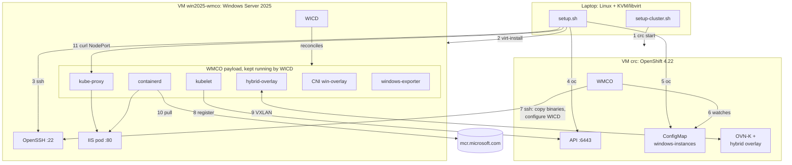
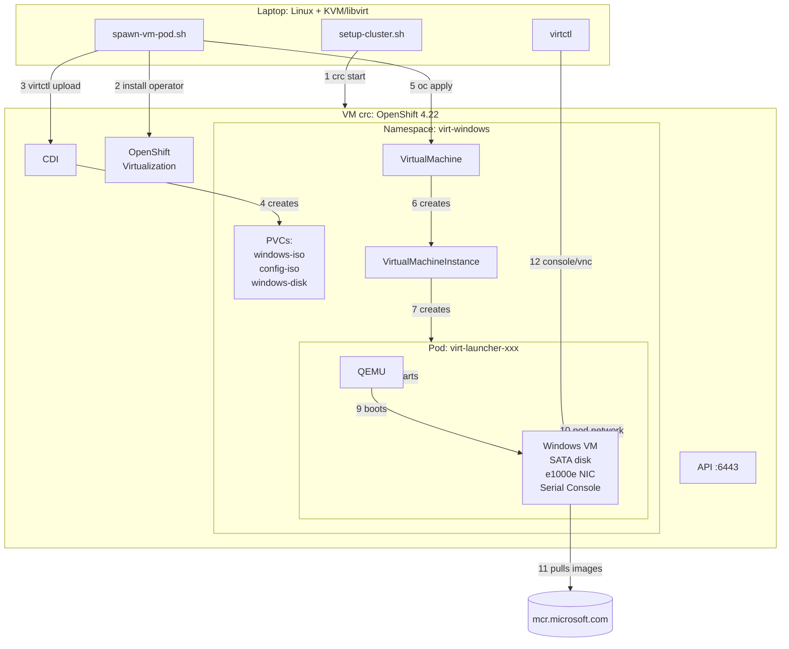

# Windows on OpenShift Lab

Lab environment demonstrating Windows workloads on OpenShift through two approaches: **WMCO BYOH** (Windows nodes joined to the cluster) and **VM-as-Pod** (Windows VMs running as pods using OpenShift Virtualization).

## Purpose

This repository provides:
- Automated setup scripts for Windows on OpenShift environments
- Two approaches to running Windows workloads
- Documentation of learnings and best practices
- Feature proposals for upstream contributions

**Target audience:** Engineers learning Windows on OpenShift, testing WMCO/KubeVirt, or developing upstream features.

## Architecture

### Approach 1: WMCO BYOH (Bring-Your-Own-Host)

Traditional Windows nodes joined to the cluster via Windows Machine Config Operator.



**How it works (WMCO BYOH):**

| # | Component → Component | What happens |
|---|---|---|
| 1 | setup-cluster.sh → CRC | Creates OpenShift cluster (crc), enables hybrid overlay networking |
| 2 | setup.sh → Windows VM | Creates Windows VM with autounattend.xml for unattended install |
| 3 | setup.sh → OpenSSH | Configures Windows over SSH (features, updates, health checks) |
| 4 | setup.sh → API | Installs WMCO operator via OLM, stores SSH key as Secret |
| 5 | setup.sh → ConfigMap | Writes Windows IP to `windows-instances` ConfigMap (triggers BYOH) |
| 6 | WMCO → ConfigMap | Watches ConfigMap, reacts to new/removed Windows nodes |
| 7 | WMCO → OpenSSH | Copies payload binaries, configures WICD daemon |
| 8 | kubelet → API | Windows node registers with cluster |
| 9 | hybrid-overlay ↔ OVN | VXLAN tunnel (UDP 4789) for pod-to-pod networking |
| 10 | containerd → MCR | Pulls Windows container images |
| 11 | setup.sh → kube-proxy | Verifies IIS pod via NodePort (health check) |

### Approach 2: VM-as-Pod (OpenShift Virtualization)

Windows VMs running as pods using KubeVirt.



**How it works (VM-as-Pod):**

| # | Component → Component | What happens |
|---|---|---|
| 1 | setup-cluster.sh → CRC | Creates OpenShift cluster with resources for nested virtualization |
| 2 | spawn-vm-pod.sh → Virtualization | Installs OpenShift Virtualization operator (HyperConverged CR) |
| 3 | spawn-vm-pod.sh → CDI | Uploads Windows ISO and config ISO via virtctl image-upload |
| 4 | CDI → PVCs | Creates PersistentVolumeClaims for ISOs and Windows disk |
| 5 | spawn-vm-pod.sh → VM | Creates VirtualMachine CR (SATA bus, e1000e NIC, EMS console) |
| 6 | VirtualMachine → VMI | KubeVirt creates VirtualMachineInstance (running VM) |
| 7 | VMI → virt-launcher pod | Pod wraps QEMU process and manages VM lifecycle |
| 8 | virt-launcher → QEMU | Starts QEMU with VM configuration |
| 9 | QEMU → Windows VM | Boots Windows from ISO, autounattend.xml drives installation |
| 10 | Windows VM → pod network | Connects to pod network via masquerade mode |
| 11 | Windows VM → MCR | Pulls container images (after Windows installation) |
| 12 | virtctl → Windows VM | Connects to serial console (EMS) or VNC |

## Glossary

### WMCO BYOH Terms

| Term | Description |
|------|-------------|
| **WMCO** | Windows Machine Config Operator - manages Windows nodes in OpenShift |
| **BYOH** | Bring-Your-Own-Host - add existing Windows VMs as cluster nodes |
| **WICD** | Windows Instance Config Daemon - keeps WMCO payload services running |
| **hybrid-overlay** | OVN-Kubernetes mode for Linux/Windows pod networking |
| **VXLAN** | Virtual Extensible LAN - tunnel protocol (UDP 4789) for pod traffic |
| **ConfigMap** | `windows-instances` - triggers WMCO to configure Windows nodes |
| **containerd** | Container runtime for Windows |
| **win-overlay** | CNI plugin for Windows pod networking |
| **autounattend.xml** | Windows unattended installation answer file |
| **CRC** | OpenShift Local (formerly CodeReady Containers) |

### VM-as-Pod Terms

| Term | Description |
|------|-------------|
| **OpenShift Virtualization** | KubeVirt-based virtualization platform for OpenShift |
| **KubeVirt** | Kubernetes extension for running VMs as pods |
| **VirtualMachine (VM)** | Custom resource defining a VM |
| **VirtualMachineInstance (VMI)** | Running instance of a VM |
| **virt-launcher** | Pod that wraps the QEMU process |
| **CDI** | Container Data Importer - handles ISO/disk image uploads |
| **PVC** | PersistentVolumeClaim - storage for VM disks and ISOs |
| **virtctl** | CLI tool for VM operations (console, VNC, upload) |
| **EMS** | Emergency Management Services - Windows serial console |
| **SATA bus** | Storage bus required for Windows (SCSI doesn't work) |
| **e1000e** | Network adapter with native Windows drivers |
| **masquerade mode** | KubeVirt networking mode (VM uses pod network) |
| **nested virtualization** | VM inside VM (host KVM → CRC → QEMU → Windows) |

## Quick Start

**WMCO BYOH:**
```bash
./setup-cluster.sh   # Create OpenShift cluster
./setup.sh           # Create Windows node + WMCO
```

**VM-as-Pod:**
```bash
./setup-cluster.sh      # Create OpenShift cluster
./spawn-vm-pod.sh windows   # Create Windows VM as pod
```

## Screenshots

**WMCO BYOH approach:**

| | |
|---|---|
|  Windows Update phase - VM console showing updates |  WMCO joins the node, IIS workload starts |
|  Setup complete - all phases pass, IIS responds |  `./setup.sh health` output |
|  IIS served from Windows node - all checks passed | |

## Documentation

**Setup & Usage:**
- Run `./setup.sh --help` for WMCO BYOH setup options
- Run `./spawn-vm-pod.sh --help` for VM-as-Pod setup options
- Run `./run-ci.sh` for CI testing

**Guides:**
- **[docs/VM-AS-POD.md](docs/VM-AS-POD.md)** - VM-as-Pod deployment guide
- **[docs/VM-OPERATIONS.md](docs/VM-OPERATIONS.md)** - VM lifecycle and operations
- **[features/README.md](features/README.md)** - Lab features catalog and roadmap

## Requirements

- **Host:** 42GB+ RAM, 8+ cores, 150GB disk, nested virtualization
- **OS:** Fedora/RHEL/Ubuntu Linux with KVM
- **Software:** libvirt, qemu-kvm, OpenShift Local (crc), virtctl
- **Windows ISO:** Windows Server 2025 Evaluation (place at `/var/lib/libvirt/images/`)
- **Red Hat pull secret:** https://console.redhat.com/openshift/create/local

## References

- [WMCO Documentation](https://github.com/openshift/windows-machine-config-operator)
- [OpenShift Local (CRC)](https://developers.redhat.com/products/openshift-local/overview)
- [OpenShift Virtualization](https://docs.openshift.com/container-platform/latest/virt/about_virt/about-virt.html)
- [KubeVirt](https://kubevirt.io/)


### Windows Internals & Kernel Study Resources

While Microsoft discontinued the **Windows Academic Program** after **Windows Research Kernel (WRK) v1.2** (based on Windows Server 2003 SP1 / XP x64) and never released modern Windows 10/11 kernel source kits, the following resources are available for studying Windows architecture and internals:

* **[Windows Internals, 7th Edition (Part 1 & Part 2)](https://microsoft.com):** The authoritative guide covering Windows 10 and Windows Server 2016/2019 internals on Microsoft Learn.
* **[Microsoft Sysinternals](https://microsoft.com):** Live system inspection and troubleshooting utilities (such as Process Explorer, VMMap, and LiveKd) for inspecting Windows internals at runtime.
* **[Windows Driver Kit (WDK) & WinDbg](https://microsoft.com):** Official Microsoft documentation, kernel debugging tools, and public symbol files (PDBs) for analyzing modern Windows kernel structures.
* **[Windows Research Kernel (WRK) v1.2](https://github.com) ([BetaWiki Overview](https://betawiki.net)):** Community-preserved mirror of the final 2006 academic kernel source release and Curriculum Resource Kit (CRK) materials *(for academic/reference use under Microsoft's original Shared Source terms)*.